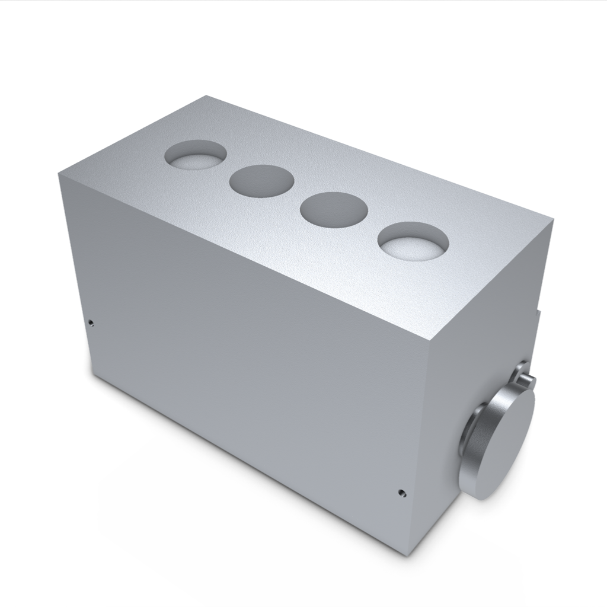
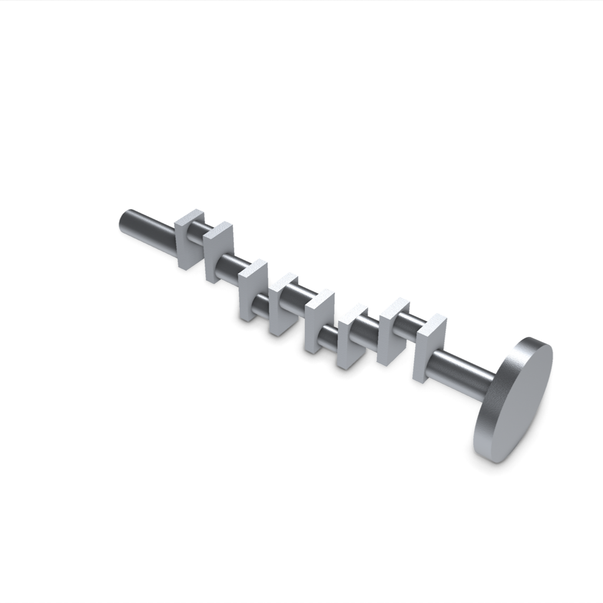

# Example index

These examples expose source and validation steps. They do not establish arbitrary generation quality or physical qualification.

## Generated assembly study

[Inline-four mechanical study](examples/generated/inline-four-study/README.md):
nine made definitions, thirty-one solid occurrences, exact STEP downloads, editable
source, and nine renders of saved CAD. The pipeline delivered files and instructions.
The assembly remains incomplete. Its rod caps, retention, timing and coordinated
motion still need work. Read the [matched trial comparison](docs/ENGINE_COMPARISON-public002.md)
for measurements and limits.

| Assembly | Crankshaft |
| --- | --- |
|  |  |

## Deterministic references

| Example | Entry point | What it demonstrates | Limit |
| --- | --- | --- | --- |
| NEMA 17 mount | `tests/fixtures/handwritten/nema17_mount_good.partdsl.json` | Deterministic PartDSL compilation and scoped validators | Hand-authored reference, not a fresh model generation |
| NEMA 17 reference | `examples/handwritten_nema17.py` | Direct build123d source and STEP/STL export | Writes files beside the script; inspect before running |
| Motor-to-extrusion adapter | `examples/handwritten_nema17_2020_adapter.py` | Composed mounting interfaces | Nominal geometry; manufacture and load remain unverified |
| Fan adapter | `examples/handwritten_fan_2020_adapter.py` | Authored adapter reference and validator report | Hardware and print assumptions remain scoped |
| Pi 4 open case | `examples/handwritten_pi4_case.py` | Open tray, standoffs, and port cutouts | No lid, retention qualification, or thermal claim |
| MCP assembly fixture | `scripts/workspace_mcp_demo.py` | Saved assembly revisions, inspection, edit, export, and sampled motion | Scripted acceptance fixture; no model-generation benchmark or physical clamping proof |

## First example

From the repository root:

```powershell
uv run --locked forge-mind validate tests/fixtures/handwritten/nema17_mount_good.partdsl.json --out-dir ./local-output/nema17
```

For the direct Python reference:

```powershell
uv run --locked python examples/handwritten_nema17.py
```

The Python reference writes generated artifacts into `examples/`. Keep those outputs out of a contribution unless a reviewed release manifest includes them.

## MCP assembly fixture

The [captured fixture gallery](examples/verified/opposed-jaw-tool-fixture/README.md)
contains the exact source and downloads from the real MCP smoke test. It has 42
occurrences. The test changes the jaw opening from 60 to 80 mm, changes a pad to
48 mm, measures the resulting jaw faces, and checks eight discrete motion poses.
It does not establish continuous-motion clearance or physical clamping performance.


Start the private workspace from the README first. Use the same extras:

```powershell
uv run --locked --extra server --extra mcp --extra fea python scripts/workspace_mcp_demo.py --output "$env:TEMP/forge-mind-mcp-demo"
```

This command runs CAD jobs and can take time. It does not invoke a built-in model. It does not accept the candidate unless you explicitly add `--accept`. Its sampled collision result covers discrete poses, not continuous motion or physical forces.

## Release showcase policy

Publish a showcase only with its source, exact revision, artifact hashes, tested claims, and known limits. Include only assets with clear rights. Do not list a complete engine as a demonstrated output until an independently reviewed result supports that claim.

