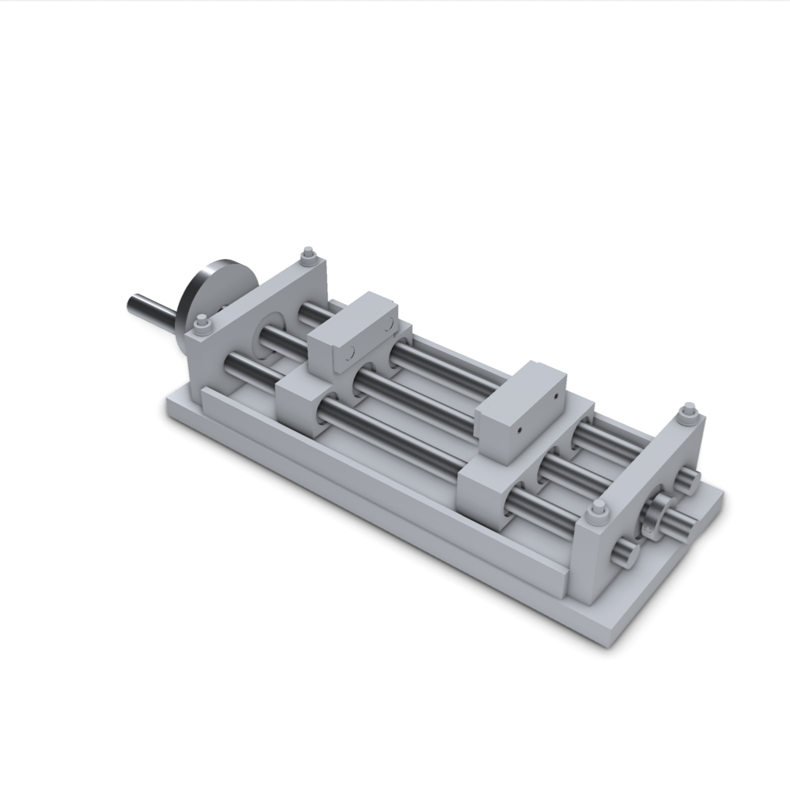
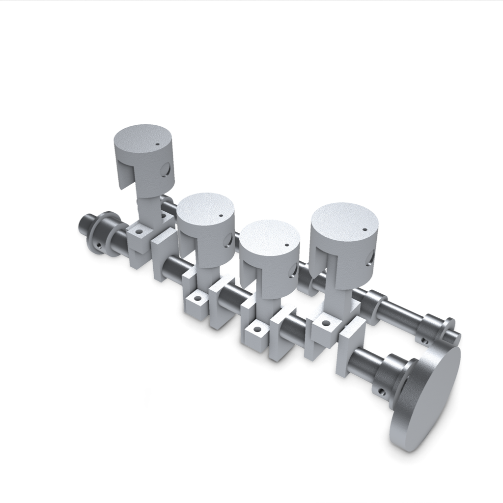
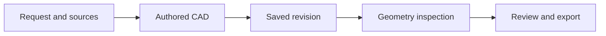

# Forge-Mind / CadKitty

Editable CAD tools for AI assistants, with saved revisions and measured evidence.

Forge-Mind lets an assistant build parts and assemblies, inspect saved geometry, revise a candidate, and export CAD files. CadKitty is the workspace and MCP tool interface. The core is Python; this snapshot does not include the hosted website or deployment setup.



A [42-component tool fixture](examples/verified/opposed-jaw-tool-fixture/README.md), exercised through the real MCP interface. It includes editable source, downloaded CAD, measured jaw spacing and a discrete motion check. It is a scripted tool example.



An actual generated [inline-four study](examples/generated/inline-four-study/README.md), shown with the block and covers hidden. The study remains incomplete. The example includes exact STEP files, instructions, source and unresolved work.

## What it does

- Build editable native features and assemblies, then change named features or parameters.
- Read saved source, topology, sections, dimensions, and scoped engineering results.
- Solve coupled planar mechanisms in XY, YZ, or ZX, with sampled motion and interference checks.
- Retain durable revisions, failed attempts, measurements, and artifact hashes for review and repair.
- Export saved STEP, STL, and GLB artifacts through the supported tool routes.



Each check has its own scope. CAD validity and renders do not certify manufactured fit, strength, safety, or complete engineering function.

## Start with a deterministic example

Install [uv](https://docs.astral.sh/uv/) and use Python 3.11. These commands use **Windows PowerShell**, from the repository root. The project declares Python 3.11 and 3.12 support; consult the release qualification for tested platforms.

```powershell
uv sync --locked --python 3.11
uv run --locked forge-mind version
uv run --locked forge-mind validate tests/fixtures/handwritten/nema17_mount_good.partdsl.json --out-dir ./local-output/nema17
```

The last command compiles a hand-authored reference and runs its validators. It does not call a model. Read each check and its scope; the command's overall result is not physical qualification.

## Connect a local assistant with MCP

Use a private local workspace for trusted inputs. Install the workspace extras:

```powershell
uv sync --locked --extra server --extra mcp --extra fea --python 3.11
```

Start the service in a separate PowerShell terminal:

```powershell
$env:FORGE_WORKSPACE_LOCAL='1'
$env:FORGE_WORKSPACE_EXECUTOR='trusted_local'
$env:FORGE_WORKSPACE_DIR="$env:LOCALAPPDATA/ForgeMind/cad-tools"
$env:FORGE_FORBID_API_SPEND='1'
uv run --locked --extra server --extra mcp --extra fea uvicorn forge_mind.server.workspace_app:app --host 127.0.0.1 --port 4321
```

Keep this service on loopback. It can execute authored CAD on your computer. Choose a new workspace directory for experiments.

Add this server to your MCP-capable assistant. Replace the repository path:

```json
{
  "mcpServers": {
    "cadkitty": {
      "command": "uv",
      "args": ["--directory", "C:/path/to/Forge-Mind", "run", "--locked", "--extra", "server", "--extra", "mcp", "--extra", "fea", "cadkitty-mcp"],
      "env": {"FORGE_MCP_WORKSPACE_URL": "http://127.0.0.1:4321"}
    }
  }
}
```

Keep the same extras in each command. The assistant starts the stdio bridge; the bridge alone waits for a client. Set the same loopback URL on both sides if you change the port.

Ask the assistant to call `get_status` first. It reports the workspace connection and current capabilities. Exports default to `~/Downloads/CadKitty`; set `FORGE_MCP_EXPORT_DIR` in the MCP server environment to choose another directory.

With ordinary CAD tools, the calling assistant authors the design. `create_project` creates an empty project; `submit_document` queues CAD without a built-in model call. The `ai_create_project` and `ai_edit_project` tools use the workspace's installed, signed-in Codex CLI. Set `FORGE_CODEX_EXE` if that executable is outside PATH. Built-in AI calls can use subscription limits or credits; `FORGE_FORBID_API_SPEND=1` does not make them free.

## Examples and evidence

See [EXAMPLES.md](EXAMPLES.md) for deterministic references and their limits. [Architecture](docs/ARCHITECTURE.md) explains the code paths; [principal-plane mechanisms](docs/PRINCIPAL_PLANES.md) describes the coordinate rules.

`SNAPSHOT.json` records source origin, file hashes, and exclusions. `RELEASE_QUALIFICATION.json` records the standalone checks and exact tested bytes. Read evidence for the exact release instead of treating historical test totals as current results. Historical north-star specifications have separate [availability notes](scripts/north_star_loop/README.md).

For development, see [CONTRIBUTING.md](CONTRIBUTING.md). For trust boundaries and reporting, see [SECURITY.md](SECURITY.md).

Read the [reproduction guide](docs/REPRODUCIBILITY.md), [mechanism coordinate contract](docs/PRINCIPAL_PLANES.md), and [measured engine comparison](docs/ENGINE_COMPARISON-public002.md) for details.

## License

MIT, copyright Brennen Johnson. Third-party packages and imported assets retain their own terms. Optional extras can add licensing and platform requirements.

