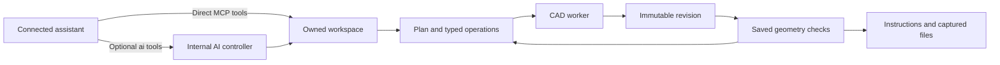

# How the workspace works

The workspace keeps intent, CAD and evidence separate. A model can propose a design.
It cannot turn its own description into a measured result.

## Two authoring routes

With ordinary MCP tools, the connected assistant authors the CAD directly.
`create_project` creates an empty project. `submit_document` queues the assistant's
native document, and `edit_variables` changes saved parameters. These tools do not
invoke an inner model. The assistant can read source, inspect geometry, edit and
export through the same tool interface.

The optional `ai_create_project` and `ai_edit_project` tools invoke the workspace's
internal AI controller. That controller uses the configured provider and consumes
its usage allowance. The installed Codex client is the supported route in this
snapshot. Ordinary MCP authoring does not require this controller. See
[mcp_server.py](../src/forge_mind/workspace/mcp_server.py).

The native author uses editable features, profiles, extrusion, cuts, patterns,
assembly placement and feature edits. The compiler executes them with build123d
and OpenCASCADE. Legacy Python authoring remains a separate trusted-code path.
See [document.py](../src/forge_mind/workspace/document.py) and
[construction_reference.py](../src/forge_mind/workspace/construction_reference.py).

Edits to existing CAD and plans use revision, input-version, or plan guards. The
store rejects stale writes. Atomic plan/CAD updates preserve ownership together.
Durable revisions retain source, failed attempts, measurements and artifact hashes.
See [edit_contracts.py](../src/forge_mind/workspace/edit_contracts.py),
[plan_patch.py](../src/forge_mind/workspace/plan_patch.py) and
[store.py](../src/forge_mind/workspace/store.py).

The worker exports STEP and display meshes. Inspection reads saved source and
artifacts and checks their identities. Tools cover topology, sections, dimensions,
nominal material comparisons and finite mechanical studies. Admitted requirements
remain separate from authored design targets. A match to an authored target does
not establish complete source conformance. See
[product_tools.py](../src/forge_mind/workspace/product_tools.py),
[measure.py](../src/forge_mind/workspace/measure.py) and
[verification_admission.py](../src/forge_mind/workspace/verification_admission.py).

Coupled mechanisms solve in local two-dimensional coordinates. Shared rigid
transforms place components in XY, YZ or ZX and move saved bodies between poses.
Ports and sampled interference checks use the same coordinate rules.
This adds plane placement, not spatial dynamics or continuous-motion proof. See
[mechanism.py](../src/forge_mind/workspace/mechanism.py) and
[principal-plane mechanisms](PRINCIPAL_PLANES.md).

Completion checks actual construction, current evidence, instructions and requested
outputs. A missing component remains unfinished work. A physical duty can remain
unverified even when the digital files are complete. The final proof retains
unsupported duties as unverified alongside measured scalar findings. See
[completion.py](../src/forge_mind/workspace/completion.py),
[native_finish.py](../src/forge_mind/workspace/native_finish.py) and
[requirement_verification.py](../src/forge_mind/workspace/requirement_verification.py).

The optional internal agent receives current state, typed tool interfaces and
bounded history. Saved revisions retain the durable record. Each model call uses
the selected state and tool context; retaining a revision does not require a model
call. Rejected operations return
structured feedback. It can inspect, revise and resume; it does not get an automatic
success override. See [agent.py](../src/forge_mind/workspace/agent.py),
[agent_memory.py](../src/forge_mind/workspace/agent_memory.py) and
[codex_client.py](../src/forge_mind/llm/codex_client.py).

## Public examples

Every released example should include native source, exact CAD hashes, its origin,
its test scope and known limits. The showcase exporter validates captured package
members before copying them. A rendered image depicts saved geometry; it cannot
prove strength, manufacturing fit or continuous motion.

## Boundaries

This source snapshot supports local development and assistant integration. It does
not configure a public hosted service. Use the security guidance before executing
CAD code or accepting uploaded files.
