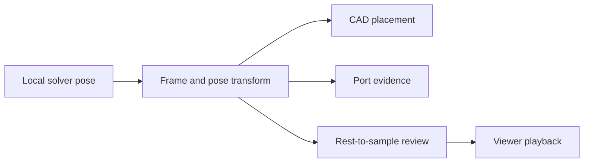

# ADR 0231: One frame transform for principal-plane mechanisms

Date: 2026-10-20. Status: implemented and locally qualified; no production deployment.

## Problem

The mechanism solver uses planar coordinates. Its placement and playback consumers
assumed world XY, even when a customer needs a shaft along X or Y. Changing only
the geometry would leave ports, motion checks, and browser playback inconsistent.

## Decision

Preserve the existing local pose `[x, y, angle_degrees, z]` and XY default. Add
exactly two supported frames:

| Frame | Local coordinates to world coordinates |
| --- | --- |
| `planar_xy_mm_deg` | `[x, y, z]` |
| `planar_yz_mm_deg` | `[z, x, y]` |
| `planar_zx_mm_deg` | `[y, z, x]` |

These are right-handed rigid rotations. Local z remains fixed depth along the
plane normal. Joint positions, slider directions, and solver equations remain
local. Customer envelope axes and source measurements remain in their declared
world frame.

Use one shared backend pose transform for CAD placement, port evidence, and
saved-body review. Move exported rest geometry with
`world(sample) @ inverse(world(rest))`. The frontend uses the same convention and
refuses unknown frames. The backend and frontend changes must qualify together
before a UI-facing deployment admits these frames.

## Council

Three independent proposals covered principal planes, arbitrary rigid plane
frames, and Docker motion-job support. Anonymous peer review ranked principal
planes first in all three reviews. Each reviewer ranked arbitrary frames second
and Docker motion admission third. The decision follows that unanimous ranking.

Arbitrary oblique frames need a broader wire and validation contract. Docker
motion admission also needs process ownership and recovery work; removing its
existing executor guard would not supply those guarantees. Both remain deferred.

## Acceptance

- Preserve absent-frame and explicit-XY serialization and document hashes.
- Check proper rotations and independent analytical point/pose oracles.
- Preserve local closure, travel, rank, and impossible-mechanism refusals.
- Verify native placement, STEP round-trip, transformed ports, and review deltas.
- Preserve stale-binding, missing-body, and collision failures.
- Verify rotated browser playback and unsupported-frame refusal.
- Run the complete backend gate and the frontend build.

This adds coordinate support. It does not establish force, wear, lubrication,
physical assembly, continuous collision freedom, or a complete working engine.
Generated examples must retain their own measured scope and unresolved duties.

## Verification

Backend focused checks and independent analytical controls pass. The native run
passes 41 tests. Six independent native fixtures cover all three planes with both
clear and colliding assemblies, transformed nested ports and STEP round-trip.
Legacy XY serialization remains unchanged. Invalid poses and unknown frames fail.

The separate frontend passes 269 workspace tests and its production build. It
validates all pose bindings before playback and preserves the design pose when
a solved sample is malformed.

Final source003 passes Ruff, formatting, mypy and the full backend suite:
11,138 passed, 48 skipped, 183 warnings in 601.05 seconds. Tests establish the
coordinate and evidence behavior above, not a complete generated engine.
