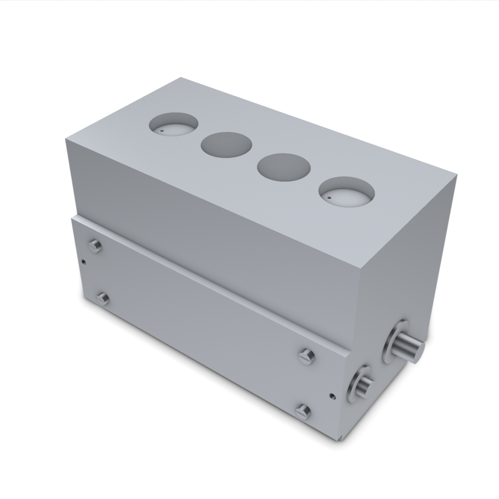
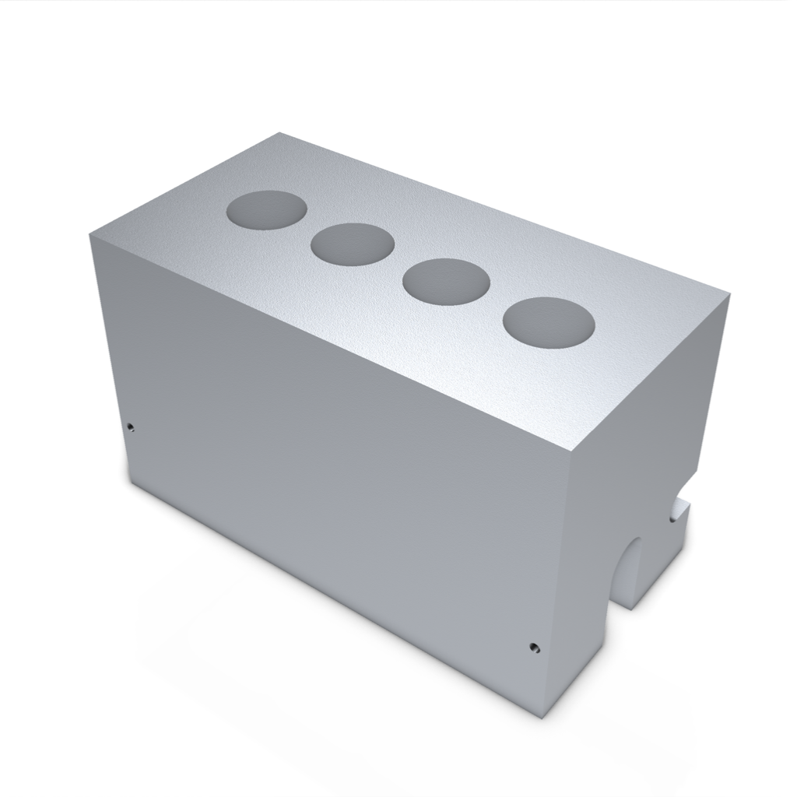
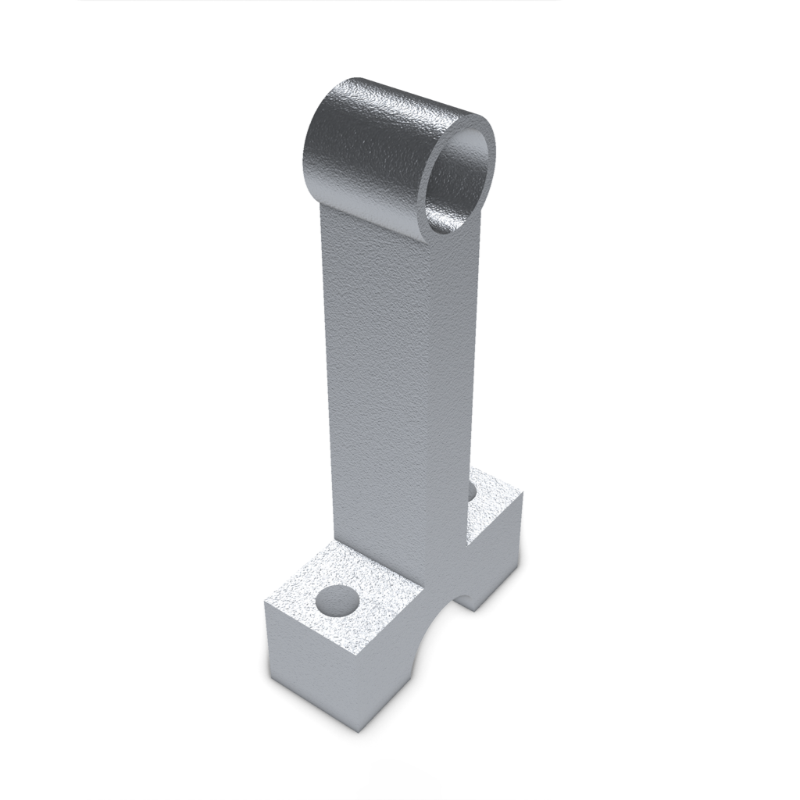
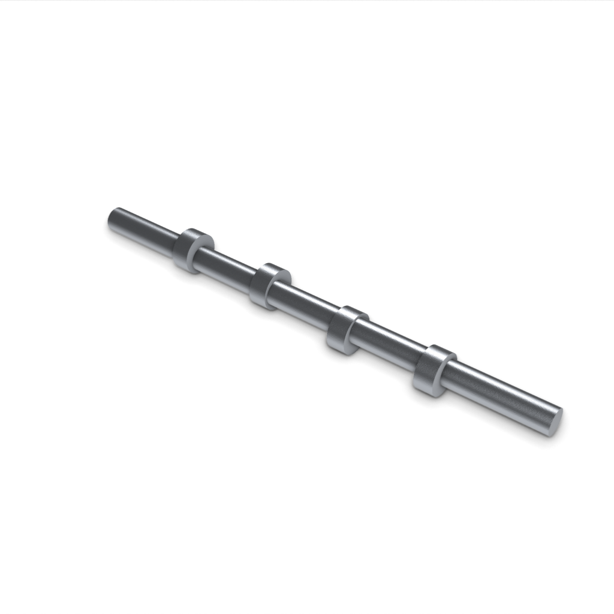
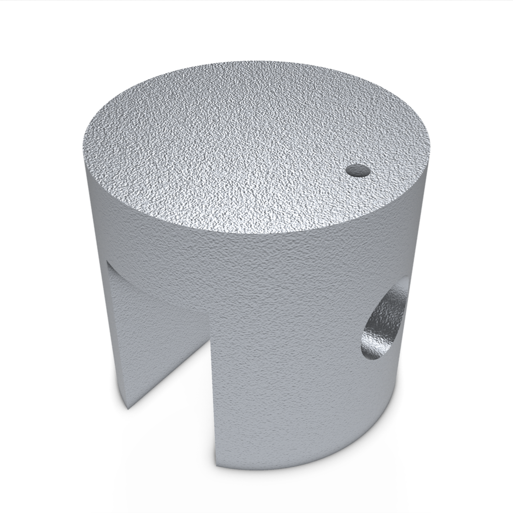
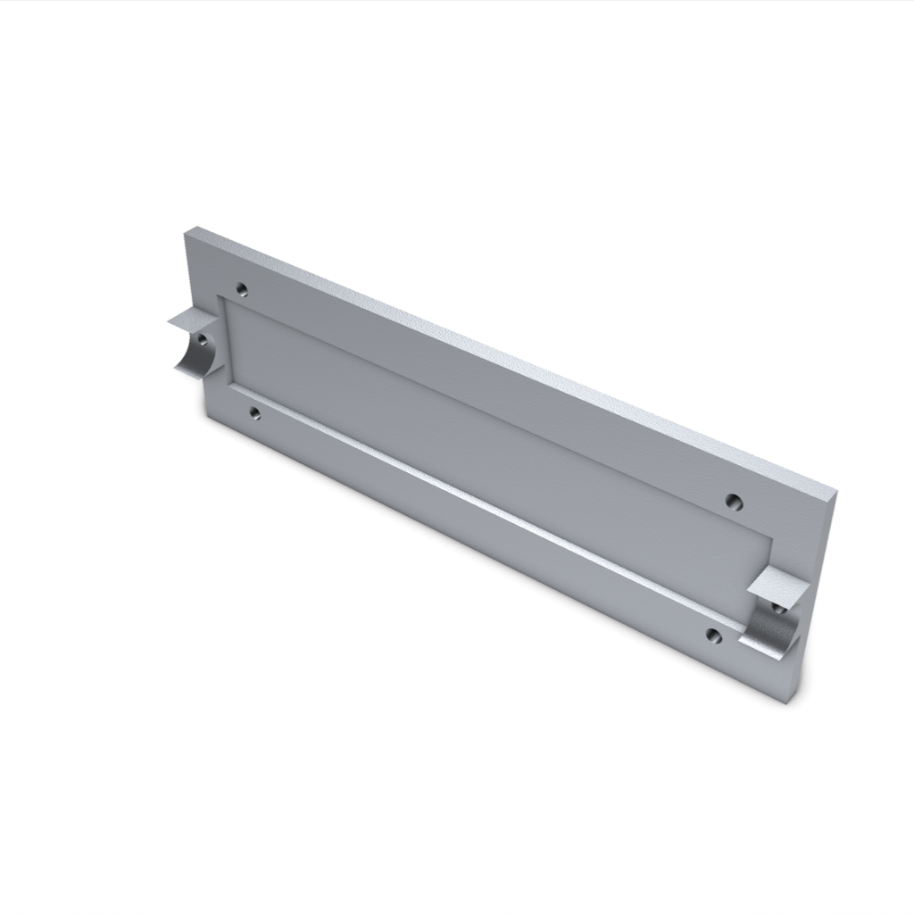

# Incomplete inline-four mechanical CAD study

This is an actual Astra-generated saved candidate, not a working engine.
It contains nine made-part definitions and 31 solid occurrences, including nominal bought hardware.
The design includes both service covers, wrist pins and an integral crankshaft handwheel.
Rod caps, retention, timing and full-cycle motion remain incomplete.

| Opposed assembly view | Block |
| --- | --- |
|  |  |

| Crankshaft | Connecting rod upper body |
| --- | --- |
|  |  |

| Camshaft | Piston | Camshaft service cover |
| --- | --- | --- |
|  |  |  |

## Selected internals

The block, both covers and their screws are hidden in this view. The 18 shown
occurrences keep their saved positions. This is not an exploded view or motion
proof. Missing rod caps remain missing. [Selection provenance](INTERNAL_VIEW_PROVENANCE.json)
binds this view to the downloaded assembly and native document.

## Download and inspect

- [Assembly STEP](cad/assembly/part.step)
- [Editable native CAD document](cad/document.json)
- [Original prompt and exact component files](cad/README.md)
- [Recorded instructions and unresolved work](cad/GUIDE.md)
- [Exact CAD file hashes](cad/manifest.json)
- [Image provenance](IMAGE_PROVENANCE.json)

## What was observed

The fixed budget was 1,800 seconds and 60 actions. The run made 18 model calls.
The project-creation to attempt-finished journal interval was 1,484.563 seconds.
This interval is not the adapter's total runtime and excludes earlier worker qualification.

Supplemental saved-STEP readback found 31 valid solids with a 172 x 83 x 95 mm envelope.
All nine made-part STEP definitions passed a separate export/import roundtrip.
The four largest cylindrical bores form an X row with their axes along Z.
Sixteen recorded nominal interface checks passed their limited geometric checks.
These observations do not establish a complete or working mechanism.

Final original-proof evaluation was unavailable. Earlier saved build findings included three
envelope passes and 18 unverified requirements. Those historical findings are not a current
final-proof result. The exact recorded guide is retained under cad/GUIDE.md; its saved-status
wording does not replace the missing final evaluation. No revision was accepted.
Full-task success remains unassessed (null), and physical readiness remains unverified.

Four matching connecting-rod caps and their screws remain absent. Shaft and wrist-pin retention,
bushing anti-rotation, camshaft drive/timing, full-cycle clearance and lubrication require work.
Materials and manufacturing processes are proposals, not measured physical properties.
Fits, tool access, strength, safe hand turning and manufacture remain unverified.

The combined assembly STL is not watertight after contact welding. Separate meshes for all
31 solids were checked as watertight; this does not make the combined assembly print-ready.
The curated CAD download therefore retains STEP and native source, not that combined STL.

These nine images render exact saved CAD or tessellations derived from captured STEP.
No image-generation model added parts. Uniform metal shading is an appearance preset.
CAD files and renders use the included MIT license. Raw project IDs, machine details,
receipts, transcripts and local paths are excluded from this gallery.
