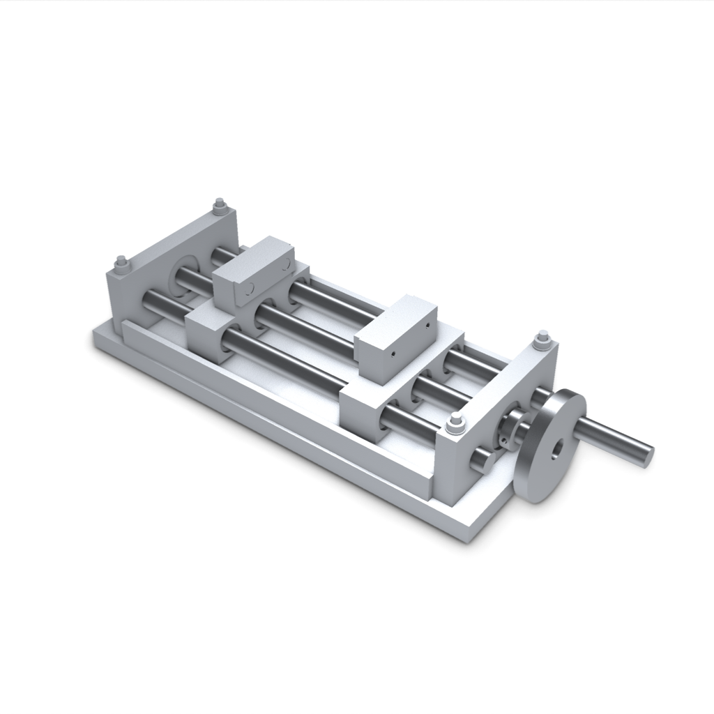

# Opposed-jaw scripted MCP tool fixture

This example comes from the existing deterministic MCP acceptance fixture.
It is not a fresh AI generation or a working, physically tested vise.
No built-in model call or candidate acceptance is requested.




## Files and observed tool route

Download [STEP](cad/part.step), [STL](cad/part.stl), [GLB](cad/part.glb),
or the [exact saved native document](cad/document.json).
[METADATA.json](METADATA.json) records sanitized measured scope and source hashes.
[IMAGE_PROVENANCE.json](IMAGE_PROVENANCE.json) binds the real rendered images.

The actual stdio MCP client creates a 42-occurrence fixture and submits native CAD.
It reads saved evidence, changes jaw opening from60 to80mm, then narrows one reusable
pad definition from50 to48mm. Only one definition rebuilds for that scoped edit.
A nominal projected-pair check measures80mm separation and a centered midpoint.
The three downloaded CAD exports are checked against their exact saved-revision hashes.
A prescribed-motion check covers its reported discrete pairs without measured overlap.
Neither prescribed motion nor sampled clearance proves screw coupling, force or retention.

## Reproduce

Use the repository's private-local MCP setup from the main README.
From the repository root, run the exact version of
[scripts/workspace_mcp_demo.py](../../../scripts/workspace_mcp_demo.py)
whose SHA256 is recorded in METADATA.json:

```powershell
uv run --locked --extra server --extra mcp --extra fea python -m scripts.workspace_mcp_demo --api http://127.0.0.1:4321 --output "$env:TEMP/cadkitty-mcp-demo-new" --timeout 1800
```

Choose a new output directory and a fresh private-local workspace. Do not add --accept
for this setup check. The script calls real stdio tools against your running local service.
CAD construction and native checks consume local runtime; no model call is built in.

## Limits

Bought fasteners, bushings and the opposed-hand drive are nominal clearance envelopes.
Thread engagement, screw-to-jaw coupling, clamping force, retention, purchased products,
materials, physical fit and manufacture remain unverified. The images use one uniform
metal preset and add no geometry. STL is saved assembly geometry, not prepared print files.
Combined-mesh printing readiness is unassessed. Full-task success remains null, and no
revision is accepted. Included CAD and images use the MIT license; dependencies retain
their own terms. Raw Store/receipts, private IDs, logs and filesystem paths are omitted.
